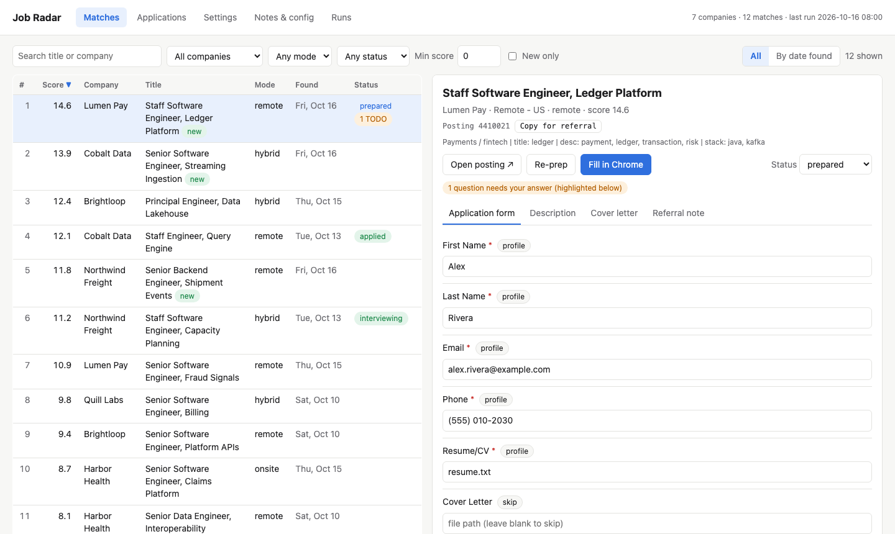
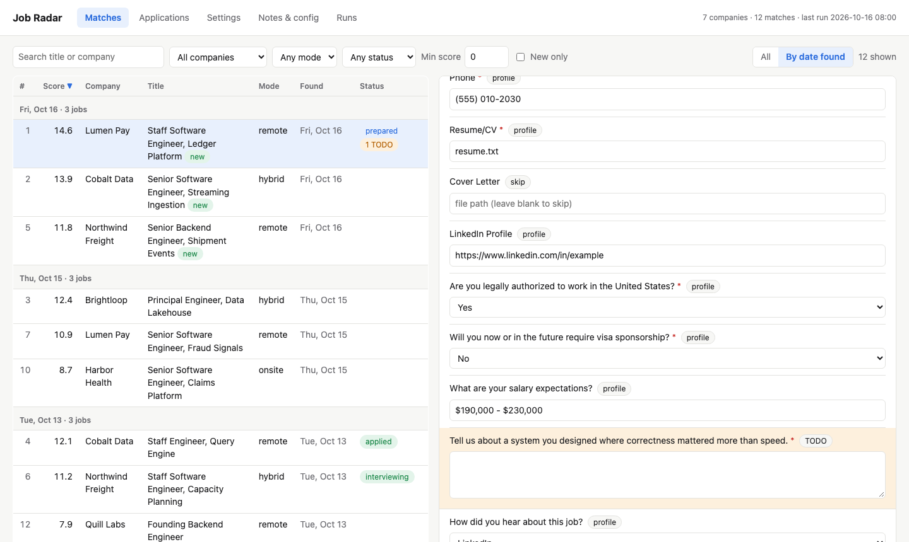
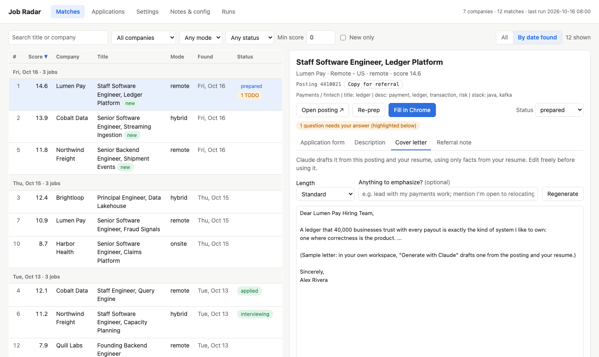
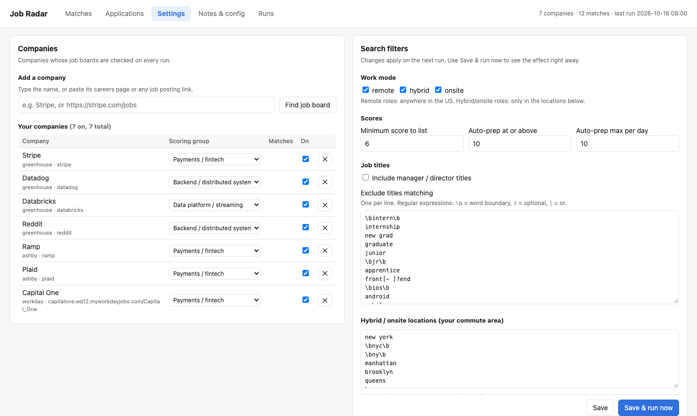
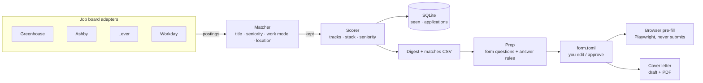

# Job Seeker

**Watch the companies you care about, straight from their job boards. Get the roles that fit you, scored and explained, with applications prepared for you to review. Nothing is ever submitted automatically.**

[](https://github.com/SidekickStarter/job-seeker-personal/actions/workflows/ci.yml)




Job aggregators show stale reposts and hide which team is hiring. Job Seeker reads company job
boards (Greenhouse, Lever, Ashby, Workday) **directly**, the same data each company's careers
page shows, and:

- **Flags new roles on every run** (e.g. each weekday morning) at the companies you choose, and filters them by title, seniority, work mode and *your* commute area (remote: anywhere in the country; hybrid/onsite: only where you'd actually go).
- **Scores and explains** every match against the kinds of work you're good at ("title: ledger · desc: kafka, payments · stack: java").
- **Prepares the application before you open it**: fetches the real form questions, answers the standard ones from your profile (work authorization, sponsorship, salary, location, EEO preferences…), and flags the few that need you.
- **Pre-fills the form in your browser** (Greenhouse, Ashby). You review it and click Submit yourself.
- **Drafts cover letters** grounded only in facts from your resume, and renders them to PDF attached to the form.
- **Helps with referrals**: requisition IDs your contact can search for internally, and a place to keep the paragraph they paste.
- Runs **on a schedule** and notifies you only when there's something new.

Everything runs locally; your profile and applications never leave your machine.

## Try it in 30 seconds

```bash
pip install "job-seeker[web] @ git+https://github.com/SidekickStarter/job-seeker-personal"
jobseeker demo        # opens the web UI on sample data (fictional companies and candidate)
```

## Set up for yourself

```bash
pip install "job-seeker[all] @ git+https://github.com/SidekickStarter/job-seeker-personal"
playwright install chromium          # for browser pre-fill and cover-letter PDFs

mkdir ~/job-search && cd ~/job-search
jobseeker init                        # creates config.toml and profile.toml here
jobseeker add "Stripe"                # or a careers page / any posting URL: finds the board
jobseeker run                         # fetch, filter, score; writes digests/digest_<date>.md
jobseeker web                         # everything else, in the browser
jobseeker schedule install --at 08:00 # weekday mornings (launchd on macOS, cron line elsewhere)
```

Then edit `profile.toml` (your details, resume path and answer rules) and `config.toml`
(companies, filters, scoring), either by hand or in the web UI's **Settings** tab.

## The workflow

| | |
|---|---|
|  |  |
| **Matches**: sort by any column, or group by the run that found them. Every application question is answered or flagged. | **Cover letters**: drafted from the posting and your resume, then edited, copied, or exported to PDF and attached to the form. |
|  | |
| **Settings**: add a company by name or link, toggle it, and tune filters and scoring. Every change is validated before saving. | |

Or from the terminal:

```
jobseeker list                       # numbered matches with status
jobseeker prep 3                     # fetch #3's form, auto-answer it -> applications/<job>/form.toml
jobseeker fill 3                     # open it pre-filled in Chrome; you review and Submit
jobseeker cover generate 3           # draft cover_letter.md (uses the local `claude` CLI)
jobseeker mark 3 interviewing
jobseeker status
```

## How it works



- **Adapters** (`jobseeker/sources/`) turn each board's public API into `Job` objects. Each one registers a `Source` with up to three capabilities: `fetch_jobs`, `fetch_form` (enables prep) and `fill` (enables browser pre-fill). Adding a board is one module: see [CONTRIBUTING.md](CONTRIBUTING.md).
- **Matching** (`matching.py`) infers work mode from structured fields when the board has them, and from location and description text otherwise ("3 days a week in the office" → hybrid, but "hybrid cloud" isn't). Then it applies your rule: remote must be in-country; hybrid/onsite must list an office in your metro.
- **Scoring** is transparent keyword matching against *tracks* you define: title hits count 3×, description hits 1× (capped), with a bonus for your stack and a penalty for stacks you avoid. Every score comes with its reasons.
- **Answers** come from ordered regex rules in `profile.toml` that map question labels to preference lists. Each preference is matched exact → prefix → substring against the form's real options.
- **Everything is files** in one workspace folder (`config.toml`, `profile.toml`, `applications/<job>/form.toml`, `digests/`), so the CLI, the web UI and your editor all see the same state.

## Design choices

- **Never auto-submit.** Mass-applying tools tend to send applications for the wrong roles. Here the human is always the last step, and the tool removes the busywork before it.
- **Direct from job boards, not aggregators.** Fresher, deduplicated, with real IDs (requisition and position IDs from Greenhouse help a referrer find the exact role internally).
- **Local and private.** No account, no server. The web UI binds to `127.0.0.1`, rejects foreign Host headers and needs a custom header on writes, so other sites can't drive it.
- **Standard library core.** Fetch, filter, score and prep need no dependencies; Flask, Playwright and pypdf are optional extras.

## Configuration reference

`config.toml` (start from [`jobseeker/templates/config.example.toml`](jobseeker/templates/config.example.toml)):

| Section | What it controls |
|---|---|
| `[settings]` | minimum score, auto-prep cutoff and daily cap, managers in or out |
| `[filters]` | what counts as an engineering title, seniority words, excluded titles (regex) |
| `[location]` | work modes to keep, your metro, places that are too far, country markers |
| `[tracks.*]` | the kinds of work you're scored against: label, weight, keywords |
| `[stack]` | bonus and penalty keywords |
| `[[companies]]` | `name`, `track`, `ats` and `slug` (or Workday `host`/`tenant`/`site`/`search`), `enabled` |

`profile.toml` (from [`profile.example.toml`](jobseeker/templates/profile.example.toml)): your details, work
authorization, salary text, EEO policy (`decline` or leave for you), and `[[rules]]` mapping question
patterns to answers. `{city}`, `{sponsorship}` and the like expand from your details.

## Limitations

- Pre-fill supports Greenhouse and Ashby forms; Lever and Workday jobs get a prep folder and a link.
- Ashby form questions and Workday search use the same endpoints their public career pages use, but they aren't documented APIs and may change.
- Cover-letter drafting shells out to the [Claude Code](https://claude.com/claude-code) CLI using your own login; `coverletter.generate(..., draft=...)` accepts any other function.
- Be a good citizen: the default schedule is once per weekday, with requests spread across a handful of boards.

## Development

```bash
git clone https://github.com/SidekickStarter/job-seeker-personal && cd job-seeker-personal
python -m venv .venv && . .venv/bin/activate
pip install -e ".[dev]"
pytest            # offline; job board responses are fixtures
ruff check .
```

## License

[MIT](LICENSE)
